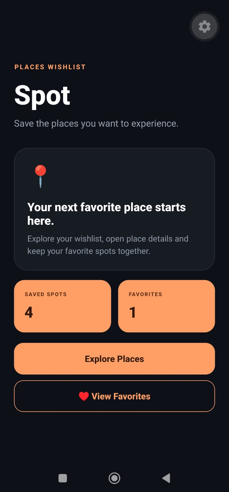
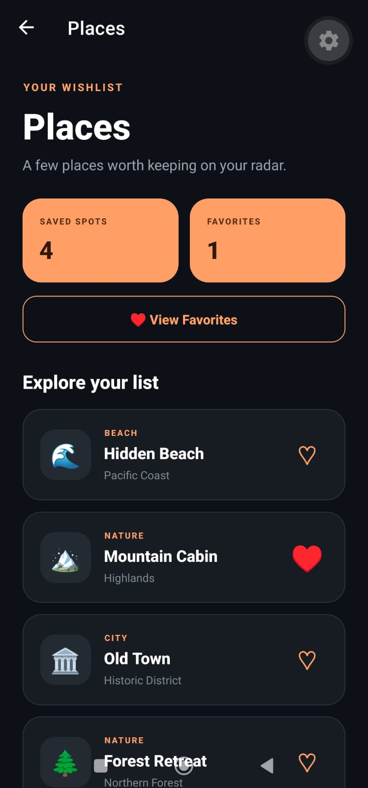
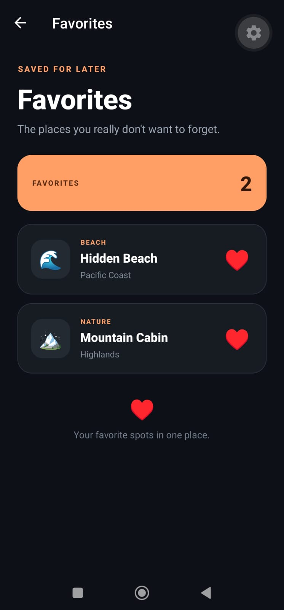
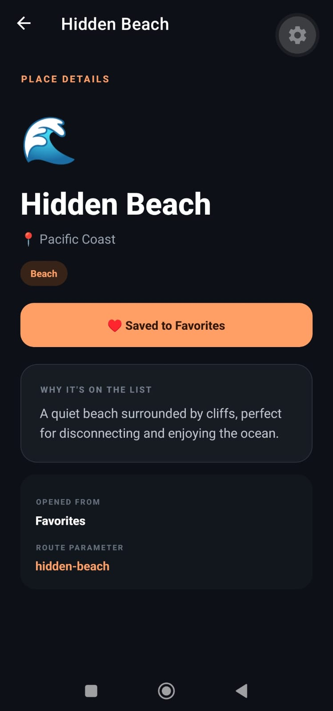

# 📍 Spot

Spot is a React Native places wishlist built with Expo and Expo Router.

The app focuses on mobile navigation patterns, dynamic routes and shared state across multiple screens.

## ✨ Features

- Places wishlist
- File-based navigation with Expo Router
- Dynamic place routes
- Dynamic navigation headers
- Route and search parameters
- Favorites shared across screens
- Favorites collection
- Empty states
- Reusable place cards
- Derived UI state

## 🧭 Navigation

Spot uses file-based routing with Expo Router.

    /
    ├── /places
    │   └── /places/[id]
    └── /favorites
        └── /places/[id]

Each place detail screen is generated from the same dynamic route:

`/places/[id]`

For example:

- `/places/hidden-beach`
- `/places/mountain-cabin`
- `/places/old-town`

Additional route parameters are used to identify whether a place was opened from the main list or the favorites screen.

## 🧠 Shared State

Favorites are managed with React Context.

The same state is consumed by:

- Home
- Places
- Favorites
- Place Details

This keeps favorite status synchronized across the navigation stack without passing state manually through every screen.

## 📱 Screenshots

### Home

  

### Places

  

### Favorites

  

### Place Details

  

## 🛠️ Tech Stack

- React Native
- Expo
- Expo Router
- React
- TypeScript

## 📚 What I Practiced

This project was built as part of a React Native learning lab.

The main goal was to practice:

- file-based mobile navigation
- Stack navigation
- dynamic routes
- typed route parameters
- local search parameters
- dynamic screen options
- shared state with React Context
- derived collections
- reusable React Native components

## 🚀 Run Locally

Install dependencies:

    npm install

Start Expo:

    npx expo start

Then open the project with Expo Go on Android or another supported Expo environment.

## 👨‍💻 Author

Víctor Hugo Segundo Aguilar

Frontend Developer focused on React, Angular, JavaScript and TypeScript, expanding into React Native and mobile development.
